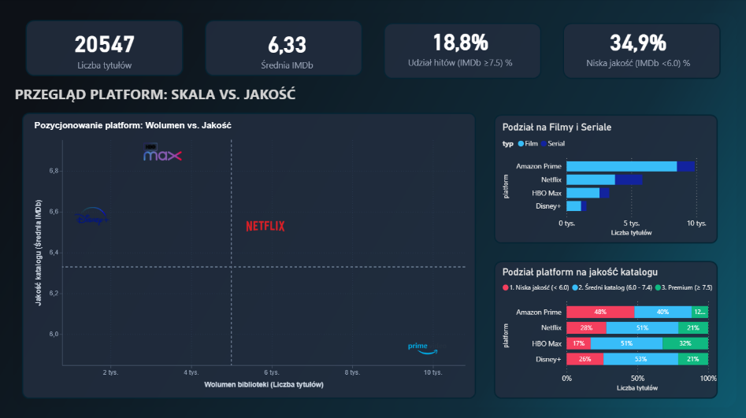
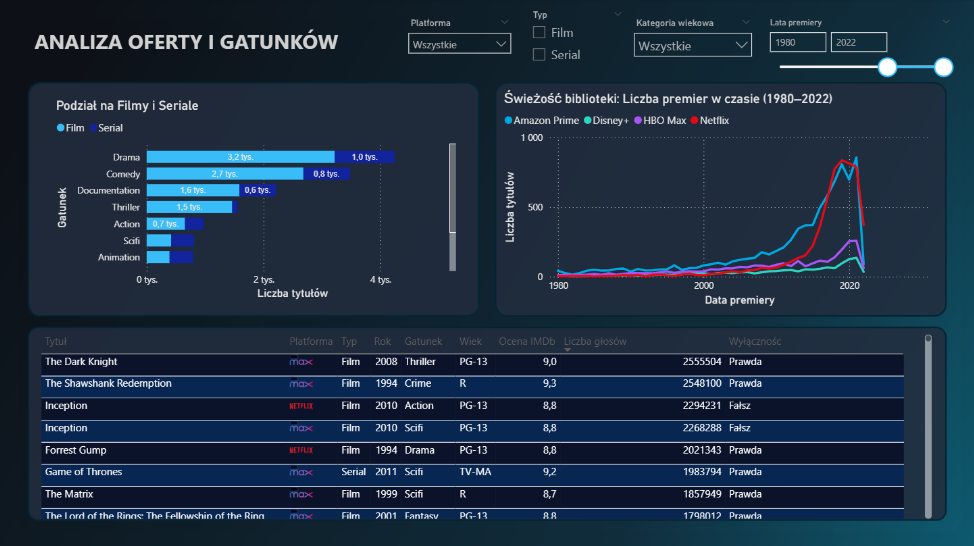

# VOD Market Intelligence: Benchmarking Strategii Katalogowych
### Analiza Porównawcza Bibliotek VOD: Amazon Prime, Disney+, HBO Max i Netflix

**Tech Stack:** `Python (pandas)` | `SQL (DuckDB OLAP)` | `Power BI` | `DAX` | `Microsoft Excel`

---

## 1. Kontekst Biznesowy i Cel Projektu

Projekt stanowi benchmarking rynkowy zrealizowany na potrzeby zdefiniowania strategii wejścia na rynek i założeń katalogowych nowej platformy streamingowej dedykowanej kinu artystycznemu, autorskiemu i festiwalowemu. Zamiast podejmować nierealną próbę bezpośredniej rywalizacji masowej z globalnymi graczami, badanie analizuje biblioteki rynkowych liderów (**Amazon Prime Video**, **Netflix**, **HBO Max**, **Disney+**) jako studia przypadków (case studies) – w celu wyciągnięcia wzorców architektonicznych (*best practices*) oraz identyfikacji błędów i pułapek operacyjnych (*pitfalls*).

Analiza bazuje na twardych metadanych katalogowych obejmujących pełną populację **20 547 unikalnych tytułów** oraz **294 785 powiązań obsadowych**. Pozwala to odpowiedzieć na fundamentalne pytania projektowe przy tworzeniu własnej usługi:
* Jak optymalnie zbilansować proporcję filmów i seriali, aby utrzymać zaangażowanie widza?
* Gdzie leży granica między rozmiarem katalogu a zadowoleniem odbiorców i dlaczego budowanie biblioteki „na wagę” jest błędem?
* Jakie luki gatunkowe i demograficzne pozostawiają giganci rynku, które może zagospodarować profilowany serwis?

---

## 2. Wnioski z Analizy Liderów Rynku (Benchmarking)

> **Podstawa analityczna:** Poniższe wnioski stanowią syntezę wyników **15 zapytań analitycznych SQL** ([`sql/queries.sql`](sql/queries.sql)) wykonanych na relacyjnej bazie w silniku DuckDB skryptem [`scripts/run_queries.py`](scripts/run_queries.py). Kompletne zestawienie danych wyeksportowano do raportu [`reports/vod_analysis_report.xlsx`](reports/vod_analysis_report.xlsx).

### Amazon Prime Video
* **Skala kosztem wizerunku:** Amazon posiada niemal połowę badanego rynku (48.03%, 9 868 tytułów), z czego 86.25% to filmy. Aż 47.90% ocenionego katalogu (3 288 pozycji) to segment niski (IMDb < 6.0), a średnia filmów wynosi zaledwie 5.76.
* **Praktyka pompowania bazy tanim kontentem:** Najczęstsi reżyserzy w bibliotece to Joseph Kane (41 filmów, średnia 5.93) i Sam Newfield (38 filmów, średnia 5.26) – twórcy westernów klasy B z lat 30. i 40. XX wieku. Amazon sztucznie powiększa wolumen pozycjami z domeny publicznej o zerowym koszcie.
* **Zapaść gatunkowa i pasywny katalog:** Kluczowy dla platformy gatunek Thriller (1 101 tytułów) notuje słabą średnią 5.49. Ponadto aż 30.44% całego katalogu (3 004 tytuły) to treści martwe – bez wiarygodnej próbki 100 ocen na IMDb.
* **Licencje zewnętrzne jako tarcza:** Tytuły dzielone z rynkiem notują wyższą średnią niż własne (6.78 vs 5.91, $\Delta = -0.86$), ratując odbiór jakościowy platformy.

### HBO Max
* **Najwyższa jakość w branży:** HBO Max wygrywa w obu formatach (filmy: 6.77, seriale: 7.30). Blisko jedna trzecia katalogu (32.03%, 855 tytułów) to segment Premium (IMDb $\ge$ 7.5), a pozycje słabe to zaledwie 17.01%.
* **Trwały cykl życia seriali:** Średnia liczba sezonów per serial wynosi 3.00 (najwięcej na rynku). HBO buduje lojalność widzów na wieloletnich markach, unikając pochopnego kasowania tytułów.
* **Profil autorski i monetyzacja dorosłych:** Czołowym reżyserem jest Charlie Chaplin (22 tytuły, średnia 7.86). Treści dla dojrzałego widza (R oraz TV-MA) stanowią łącznie 43.51% oferty, osiągając najwyższą satysfakcję (średnia TV-MA: 7.44).

### Netflix
* **Seriale jako rdzeń powracalności:** Netflix posiada najwyższy udział seriali na rynku (36.00%, 2 106 tytułów). Ponieważ format odcinkowy systemowo notuje wyższe noty niż filmy (na Netflixie: 7.00 vs 6.26), stanowi najsilniejszy czynnik stabilizujący nawyk subskrypcji.
* **Koszt wczesnego anulowania projektów:** Średnia długość serialu wynosi jedynie 2.16 sezonu (najmniej w branży). Algorytmiczne kasowanie projektów po 1–2 sezonach pozwala ciąć koszty, lecz obniża długofalową wartość biblioteki.
* **Fabryka taśmowej komedii:** Dominacja twórców stand-upów (Raúl Campos – 20 tytułów, Jan Suter – 19 tytułów, Ryan Polito – 17 tytułów) zapewnia stały dopływ taniego, premierowego materiału.
* **Najwyższa aktywność widowni:** Aż 83.79% oferty posiada zweryfikowane oceny widzów (rekord zaangażowania bazy).

### Disney+
* **Hermetyczna wyłączność:** 99.35% oferty to tytuły na wyłączność (zaledwie 10 współdzielonych z rynkiem). Jako jedyna platforma notuje odwróconą deltę jakości – produkcje własne oceniane są wyżej niż licencje zewnętrzne (6.58 vs 6.38, $\Delta = +0.20$).
* **Filar edukacyjny National Geographic:** Najliczniejszym pojedynczym gatunkiem jest Dokument (301 pozycji, średnia 7.13), przewyższający Komedię (299) i Animację (236, średnia 6.80).
* **Bariera demograficzna:** Ponad 68% katalogu to pozycje familijne, a treści dla dorosłych (TV-MA) to marginalne 6 tytułów (0.39%). Średni czas trwania filmu wynosi zaledwie 72.12 minuty ze względu na olbrzymi zasób klasycznych krótkich metraży (m.in. Wilfred Jackson – 22 tytuły, John Lasseter – 17 tytułów).

---

## 3. Rekomendacje dla Architektury Własnej Platformy

> **Wniosek Główny:** Projektując własną usługę streamingową, należy całkowicie zrezygnować z rywalizacji na wolumen z Amazonem czy uniwersalności z Netfliksem. Optymalnym kierunkiem jest profilowana platforma jakościowa zagospodarowująca luki rynkowe pozostawione przez liderów.

* **1. Sztywny próg selekcji jakościowej (Model selektywny)**  
  Doświadczenie Amazona dowodzi, że tani wolumen obniża prestiż i tworzy martwy katalog (30.44% pozycji nieoglądanych). Własna platforma powinna wdrożyć sztywny próg selekcji (np. IMDb $\ge 6.5$), opierając się na wzorcu HBO Max – mniejsza, starannie wyselekcjonowana baza buduje wyższy wskaźnik lojalności niż tysiące przeciętnych pozycji.

* **2. Format serialowy oparty na zamkniętych narracjach**  
  Seriale są niezbędne do utrzymania subskrypcji (oceny wyższe o 0.5–1.4 pkt IMDb niż filmy). Zamiast powielać frustrującą dla widzów politykę Netfliksa (masowe kasowanie po 2. sezonie; średnia 2.16), optymalną strategią jest promowanie domkniętych miniseriali oraz z góry zaplanowanych formatów 2–3 sezonowych (standard HBO Max).

* **3. Zagospodarowanie luki kina dojrzałego i autorskiego**  
  Disney+ jest całkowicie zablokowany wizerunkowo w kategorii familijnej (< 1% treści dla dorosłych), a Amazon oferuje treści gatunkowe (np. thrillery) o bardzo niskiej nocie (5.49). Ponieważ segment TV-MA osiąga najwyższą średnią ocen w badaniu (7.44), stanowi idealną niszę rynkową dla profilowanego serwisu stawiającego na ambitne kino gatunkowe i autorskie.

* **4. Wykorzystanie licencji zewnętrznych jako katalizatora startowego**  
  Budowa rozpoznawalności wymaga czasu. Zewnętrzne licencje na sprawdzone klasyki filmowe pozwalają natychmiast uwiarygodnić katalog (na Amazonie licencje podnoszą średnią ocen aż o 0.86 pkt względem produkcji wyłącznych).

---

## 4. Założenia Inżynierii i Struktura Danych

W ramach przygotowania bazy analitycznej wdrożono kluczowe decyzje :

* **Inżynieria Cech (Feature Engineering):** Wdrożono flagę wyłączności katalogowej `is_exclusive`, ustandaryzowano brakujące kategorie wiekowe do formatu `Unrated / Not Specified` oraz zastosowano próg wiarygodności statystycznej `has_valid_rating` (`imdb_votes >= 100`), zabezpieczający wnioski przed zaburzeniem przez pozycje o incydentalnych ocenach.
* **Integralność relacyjna 1:N:** Model danych oparto na relacji jeden-do-wielu poprzez unikalny klucz `id`, łączący tabelę metadanych `vod_titles_cleaned.csv` (20 547 wierszy) ze znormalizowaną tabelą obsady `vod_credits_cleaned.csv` (294 785 wierszy), eliminując ryzyko powstawania iloczynów kartezjańskich w zapytaniach SQL.

### Układ Katalogów Projektu

```text
├── data/
│   ├── raw/                         # Źródłowe zbiory danych 4 platform
│   └── processed/                   # Zbiory oczyszczone (schemat relacyjny 1:N)
│       ├── vod_titles_cleaned.csv   # Tabela główna metadanych (20 547 wierszy)
│       ├── vod_credits_cleaned.csv  # Relacyjna tabela obsady (294 785 wierszy)
│       └── platform_logos.csv       # Tabela logotypów platform w formacie Base64
├── scripts/
│   ├── data_cleaning.py             # Potok czyszczący i normalizujący dane
│   └── run_queries.py               # Runner DuckDB SQL + eksporter Excela
├── sql/
│   └── queries.sql                  # Zestaw 15 zapytań analitycznych ANSI SQL
├── reports/
│   ├── vod_analysis_report.xlsx     # Skonsolidowany raport analityczny (5 arkuszy)
│   ├── Wizualizacja powerBi.pbix    # Dashboard zarządczy Power BI (Dark Mode)
│   └── screenshots/                 # Wykadrowane zrzuty ekranu dashboardu
├── requirements.txt                 # Zależności środowiska Python
└── README.md                        # Dokumentacja projektu
```

### Zawartość wygenerowanego raportu Excel (`vod_analysis_report.xlsx`):
* **`1_Formaty`** – Wolumen rynku (KPI 1.1), proporcja filmów do seriali (KPI 1.2), średnie czasy trwania i sezony (KPI 1.3).
* **`2_Jakosc`** – Rozkład średnich i median IMDb (KPI 2.1), segmentacja tierów jakościowych (KPI 2.2), pokrycie wiarygodnymi ocenami (KPI 2.3).
* **`3_Wylacznosc`** – Poziom unikalności katalogów (KPI 3.1), delta jakościowa treści współdzielonych vs wyłącznych (KPI 3.2), struktura formatów w wyłączności (KPI 3.3).
* **`4_Gatunki_Wiek`** – Top 3 gatunki per platforma (KPI 4.1), rozkład kategorii wiekowych (KPI 4.2), zadowolenie w grupach wiekowych (KPI 4.3).
* **`5_Tworcy`** – Czołowi reżyserzy (KPI 5.1), analiza Star Power w segmencie Premium (KPI 5.2), twórcy obecni na wielu platformach (KPI 5.3).

---

## 5. Wizualizacja Zarządcza i Wnioski Decyzyjne (Power BI)

Raport wdrożono w **Power BI Desktop** (plik: [`reports/Wizualizacja powerBi.pbix`](reports/Wizualizacja%20powerBi.pbix)) w architekturze **Dark Mode**. Dashboard stanowi narzędzie decyzyjne przekładające benchmarking konkurencji na konkretne wytyczne produktowe dla nowej platformy:

---

### Dashboard 1: Przegląd Platform – Skala vs. Jakość (Executive Macro Overview)

Pulpit zarządczy pozycjonujący czterech graczy na macierzy kompromisu między wolumenem a zadowoleniem odbiorców.



#### Wnioski Decyzyjne dla Projektu Nowej Platformy:
* **Sztywny próg selekcji zamiast budowy „na wagę”:** Zaktualizowany wykres 100% jakości ujawnia, że HBO Max osiąga 32% pozycji Premium ($\ge 7.5$) przy zaledwie 17% pozycji słabych, podczas gdy Amazon Prime aż 48% bazy poświęca na tytuły poniżej progu 6.0. **Rekomendacja:** Wdrożenie sztywnego odcięcia katalogowego (IMDb $\ge 6.5$) i ograniczenie wielkości startowej do 1 500 pozycji zamiast pompowania wolumenu tanim kosztem.
* **Autorski serial jako bezpiecznik retencyjny:** Format odcinkowy systemowo notuje wyższe noty o 0.7–1.4 pkt na każdej platformie i stanowi filar powracalności Netfliksa (36% oferty). **Rekomendacja:** Nowy serwis autorski nie może wystartować wyłącznie z filmami – niezbędne jest pozyskanie domkniętych miniseriali autorskich, aby zminimalizować wskaźnik rezygnacji po jednorazowym seansie.

> **Wdrożenie Techniczne:** Customowy wykres kwadrantów w **Deneb (Vega-Lite)** z logotypami w Base64, dynamicznymi progami (5 000 tytułów i ocena 6.33) oraz filtrowaniem krzyżowym (*Cross-filtering* z przygaszaniem nieaktywnych platform do 20% przezroczystości).

---

### Dashboard 2: Analiza Oferty i Gatunków (Content Deep Dive)

Pulpit diagnostyczno-operacyjny umożliwiający szczegółową dekompozycję struktury gatunkowej, dynamiki premier oraz audyt konkretnych tytułów.



#### Wnioski Decyzyjne dla Projektu Nowej Platformy:
* **Zagospodarowanie próżni kina dojrzałego (TV-MA / R):** Treści dla dorosłych generują najwyższe zadowolenie na rynku (średnia 7.44 IMDb). Disney+ posiada w nim barierę wizerunkową (<1% oferty), a Amazon notuje zapaść jakościową w thrillerach (5.49). **Rekomendacja:** Skupienie oferty na bezkompromisowym kinie festiwalowym i dojrzałym pozwala uniknąć bezpośredniej walki z Disneyem o widza familijnego.
* **Zakup licencji zewnętrznych jako katalizatora zaufania:** Tabela tytułów demaskuje, że hity najwyższej próby (*Inception* 8.8, *Titanic* 7.9) są licencjami współdzielonymi (flaga `Wyłączność = Fałsz`). **Rekomendacja:** Na etapie wejścia na rynek 30–40% budżetu należy przeznaczyć na licencje niewyłączne sprawdzonych klasyków (lata 1970–2005), które natychmiast uwiarygadniają katalog taniej niż produkcja własna.
* **Dynamika premier a walka o nisze (Case Study: Animacja):** Choć Disney+ uchodzi za synonim animacji, analiza osi czasu demaskuje zaskakującą asymetrię: aż 48% animacji Disneya to pozycje sprzed 2000 r. (od 2018 r. dodano zaledwie 25 nowości). W tym samym czasie Netflix – odpowiadając na wycofanie licencji przez Disneya – wypuścił aż 194 nowe animacje (głównie seriale i anime), przejmując świeżą widownię. **Rekomendacja:** Postrzegana dominacja lidera gatunkowego bywa złudzeniem opartym na archiwum; nowa platforma może wygrać niszowy segment regularnością świeżych, autorskich premier.

> **Wdrożenie Techniczne:** Architektura **Measure Branching w DAX** (oddzielenie atomowych miar bazowych od wskaźników złożonych `Quality Delta`), optymalizacja relacji 1:N oraz hierarchiczne formatowanie warunkowe tabeli.

---

## 6. Szybki Start (Instrukcja Uruchomienia)

### 1. Przygotowanie środowiska
```bash
git clone https://github.com/Kuba954/streaming-market-benchmarking.git
cd streaming-market-benchmarking

python -m venv venv
# Windows:
venv\Scripts\activate
# Linux/macOS:
source venv/bin/activate

pip install duckdb pandas openpyxl
```

### 2. Odtworzenie potoku czyszczenia danych (Opcjonalnie)
```bash
python scripts/data_cleaning.py
```

### 3. Uruchomienie zapytań analitycznych i eksportu Excela
```bash
python scripts/run_queries.py
```
*Skrypt wykonuje zapytania SQL na silniku DuckDB, wyświetla podsumowanie tabelaryczne w terminalu i zapisuje kompletny raport w pliku `reports/vod_analysis_report.xlsx`.*
